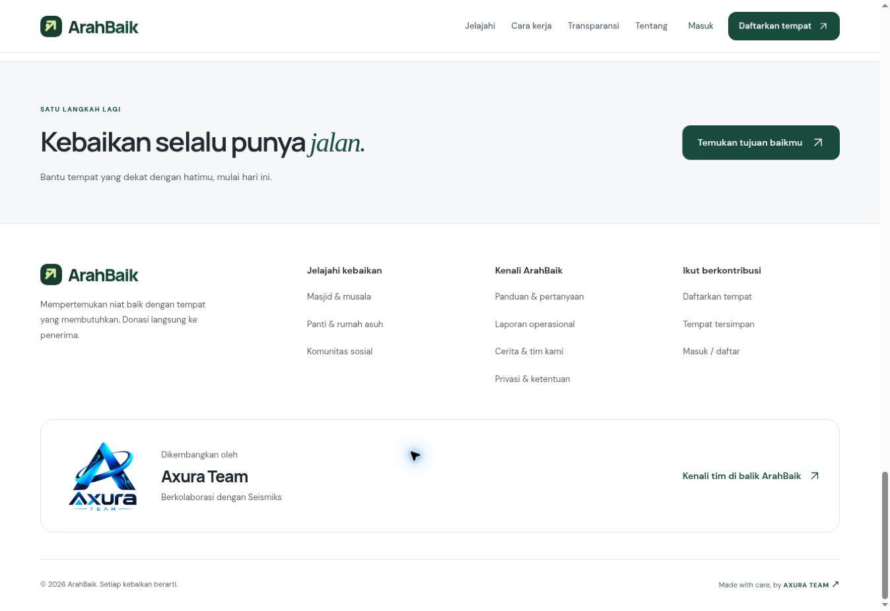

# Pemeriksaan desain dan responsivitas · 23 Oktober 2026

Latar utama sekarang putih bersih, dengan panel abu-abu terang, teks arang, dan hijau sebagai aksen tombol, tautan, serta identitas ArahBaik. Header, ajakan di atas footer, dan bagian tim menggunakan permukaan terang agar seluruh halaman tidak terasa hijau. Konten kartu tetap terpisah dari foto dan hero tetap memakai grid dalam alur dokumen biasa.

Logo resmi Axura dipertahankan tanpa mengubah asetnya. Footer memiliki ruang branding tersendiri dengan latar putih: logo 132 × 132 piksel di desktop dan 112 × 112 piksel di HP, dibandingkan 50 × 50 piksel sebelumnya. Logo di beranda juga diperbesar menjadi 100 × 100 piksel; bagian tim di halaman Tentang menampilkan logo besar pada panel putih. Tulisan biru pada logo tidak lagi bertumpuk dengan latar hijau gelap.

## Pemeriksaan browser

Browser Chrome digunakan untuk memeriksa 8 halaman pada 8 lebar viewport: **320, 375, 600, 768, 900, 1024, 1280, dan 1440 piksel**. Semua 64 kombinasi tidak memiliki overflow horizontal pada halaman. Tabel keuangan tetap dapat digeser di dalam pembungkusnya sendiri.

Halaman yang diperiksa: beranda, direktori dengan nama profil panjang, transparansi dengan nominal besar, panduan, tentang, akun, form pengajuan, dan detail profil. Form pengajuan dirender statis untuk pemeriksaan tata letak; pengujian ini tidak masuk ke akun produksi atau mengubah data Supabase. Data contoh untuk pemeriksaan kartu/laporan hanya berada di direktori pratinjau lokal, tidak di source produksi dan tidak diunggah ke database.

Pemeriksaan mencakup teks, tombol, kartu, form, dan blok branding footer. Logo serta keterangannya tidak terpotong pada lebar yang diuji. Footer HP dan desktop juga diperiksa secara visual. Menu tetap memakai perilaku buka/tutup dari versi sebelumnya.

## Pemeriksaan otomatis

37 pemeriksaan lolos: pengujian akses/database dan Worker yang sudah ada, render halaman, serta 7 pasangan warna teks normal dengan rasio kontras minimal **4,5:1**. Build frontend dan bundel Worker untuk deployment juga berhasil.

Pemeriksaan visual menggunakan build lokal. Hasil CI dan Workers Builds untuk commit yang dipublikasikan perlu dilihat pada pemeriksaan commit GitHub; keberhasilan pipeline tidak sama dengan inspeksi visual domain produksi.

